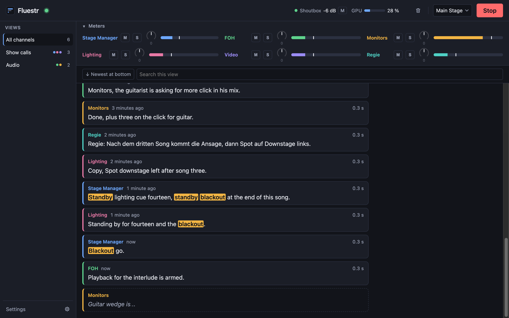
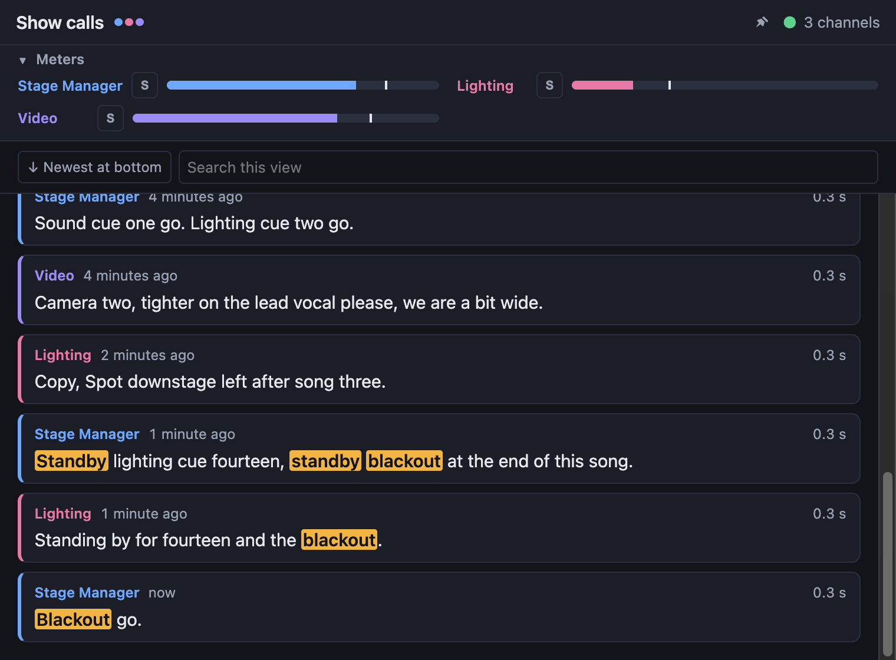
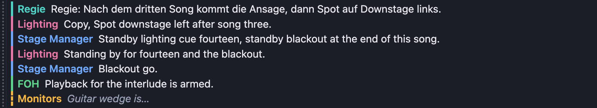
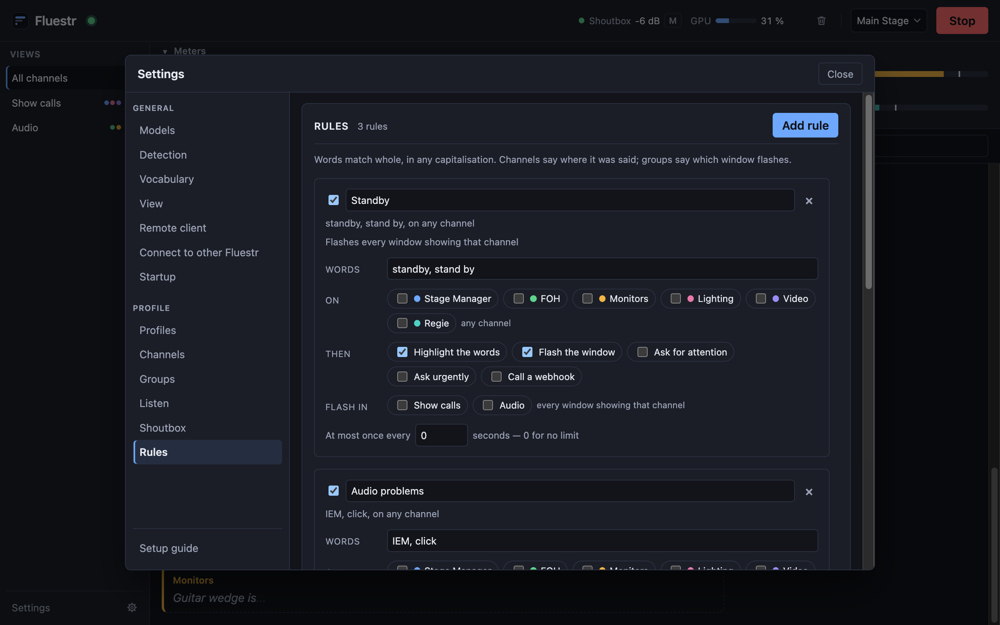
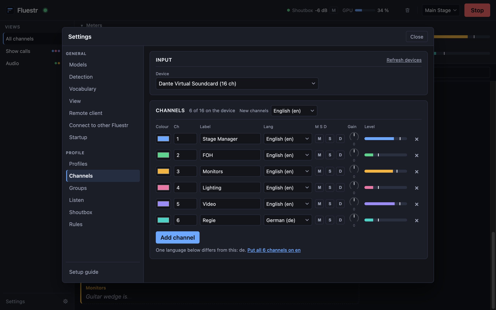
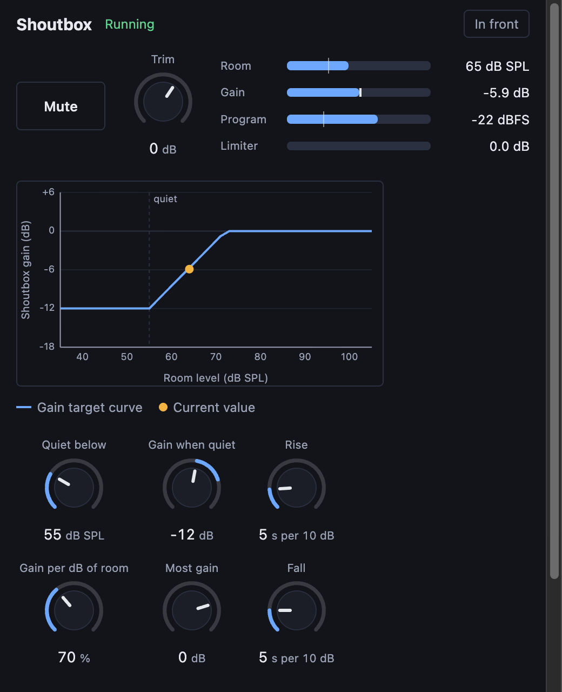
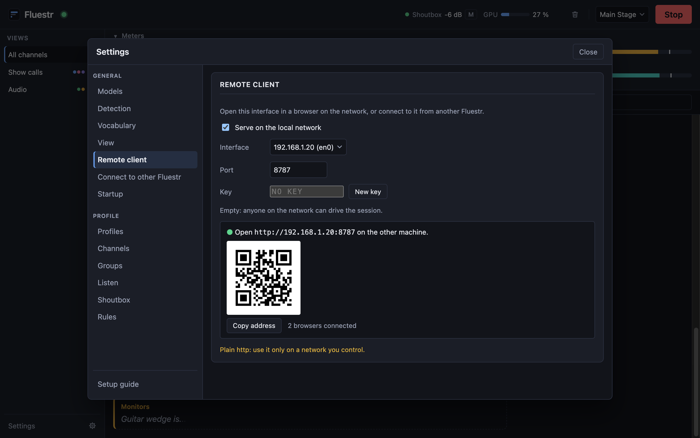
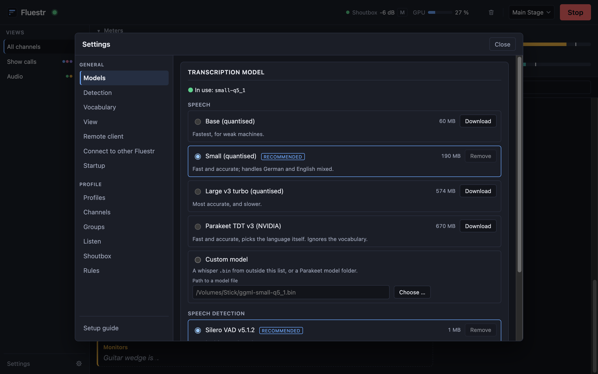

# Fluestr

**Read your intercom instead of straining to hear it.**

Fluestr listens to every intercom channel on your audio interface at the same
time and turns what is said into a live, colour-coded chat. If you miss a call
because you were busy mixing, talking or out of the room, you can scroll back
and read it. Everything runs on your own computer, with no cloud service and
no account. Once the speech model is downloaded, nothing you say leaves the
machine.

*Fluestr* comes from the German *Flüster*, "whisper", with the umlaut written
out (ü → ue), and is pronounced [ˈflʏstɐ]. The idea behind the name: turn your
shout box down and still know what was said on coms.

---

## Why it's useful

Audio engineers, stage managers and production crews often have several
intercom channels in their ears at once, and a spoken call is gone as soon as
it's over. Fluestr helps in three ways:

- **Nothing gets lost.** Every call stays on screen with the channel it came
  from and when it was said.
- **You see what matters.** Cue words like *standby* or *blackout* are
  highlighted, and a window can flash or bounce in the Dock when one comes up.
- **You can turn the coms down.** With the chat as a backup, you don't need
  the shout box at full volume all show long. Fluestr can also adjust the
  shout box level to follow the room for you.

It's fast: text usually appears about a third of a second after someone stops
talking.

## What it does

### Every channel in one chat

Choose your audio interface, choose the channels and give each one a name and
a colour. Fluestr transcribes all of them at once, so it doesn't have to pick
one at a time. While someone is still talking, a preview of their words shows
at the bottom of the chat, in italics, before the final text is ready.

Each channel has a level meter, mute (**M**) and solo (**S**). Solo sends that
channel to your headphones so you can hear the original audio.

### Groups and extra windows

Put channels into groups such as *Show calls* or *Audio*, and the sidebar
narrows the chat to a single group. Any group can be detached into a window of
its own, for example on a second screen.

For the least space, a **ticker** is a slim, borderless window that stays on
top of your other apps (a DAW, a lighting console or video software) and shows
the newest lines:

### Search and replay

Each view has its own search box, so you can find a word or narrow the chat to
one channel. If a line looks wrong, such as a cue number or a name lost in
noise, press ▶ on it to hear what was actually said. By default, Fluestr keeps
the last ten minutes of audio for replay.

### Rules: highlight, flash, alert, trigger

Rules react to words. Choose the words, which channels they count on, and what
happens when they're said:

- highlight the words in the chat
- flash the window
- ask for attention, gently or urgently (by bouncing the Dock icon, for example)
- call a webhook, for example to press a button in Bitfocus Companion or send a
  cue to another system

### Mixed languages

Fluestr is built for crews who switch languages mid-sentence, such as German
with English technical terms ("Standby für Cue fünf, dann fade out"). Set a
main language for each channel and add your house vocabulary (cue names,
positions, people's names), and the model will recognise those words more
reliably.

### A shout box that follows the room

Fluestr can also play program audio to a shout box speaker and adjust its level
to follow the room, using a measurement microphone. When the room is quiet it
stays down, and when the room gets loud it comes up. You set the curve, how
fast it moves and a safety ceiling, and the window shows where you are on the
curve.

### Remote access: connect from anywhere on the network

- **In a browser:** turn on *Serve on the local network*, then scan the QR code
  with a phone or tablet. You get the same interface, live, with no install.
  You can lock it with a key.
- **From another Fluestr:** a second computer running Fluestr, at front of
  house for example, can connect to this one under **Settings → Connect to
  other Fluestr** and pick which of its channels to show. They appear in its
  chat like local channels, and its own rules apply to them.

### Profiles

Save a setup for each venue or show, with its device, channels, groups, rules
and outputs. Fluestr recognises your audio interface even after it has been
renamed, and the profile comes back the next time you start the app.

## Getting started

1. **Download** the latest release from the
   [Releases page](https://github.com/willihelm/fluestr/releases):
   - **macOS** (Apple Silicon, macOS 13 or newer): `Fluestr_<version>_aarch64.dmg`
   - **Windows** (preview): `Fluestr_<version>_x64-setup.exe`
2. **Install it.** The macOS build isn't signed with an Apple Developer ID yet,
   so macOS blocks it the first time you open it.
   [docs/beta-install.md](docs/beta-install.md) shows the one-time steps to
   allow it.
3. **Follow the setup guide.** On first start, a short guide downloads the
   speech model (about 190 MB, the only time Fluestr needs the internet), then
   helps you pick your audio interface, its channels and your groups.
4. **Press Start.**

Fluestr checks for updates when it starts. When a new version is available, a
button appears in the header that installs it.

### Choosing a model

Under **Settings → Models** you can choose the speech model. **Small** is
recommended: it's fast and handles mixed German and English well. **Large v3
turbo** is more accurate but needs more GPU. **Parakeet** is very fast and
detects the language on its own. The GPU meter in the header shows whether
your computer is keeping up with all your channels.

## Status

Fluestr is in beta and is already used on live shows with several channels.
Some features (replay, the ticker, the shoutbox and connecting Fluestr
instances to each other) are new and
haven't yet been through many shows. The Windows version is a preview.
Feedback and bug reports are welcome in the
[issue tracker](https://github.com/willihelm/fluestr/issues).

## For developers

Building from source, the architecture, signing and tests are covered in
[docs/development.md](docs/development.md). The project plan and its progress
are in [docs/plan.md](docs/plan.md).
